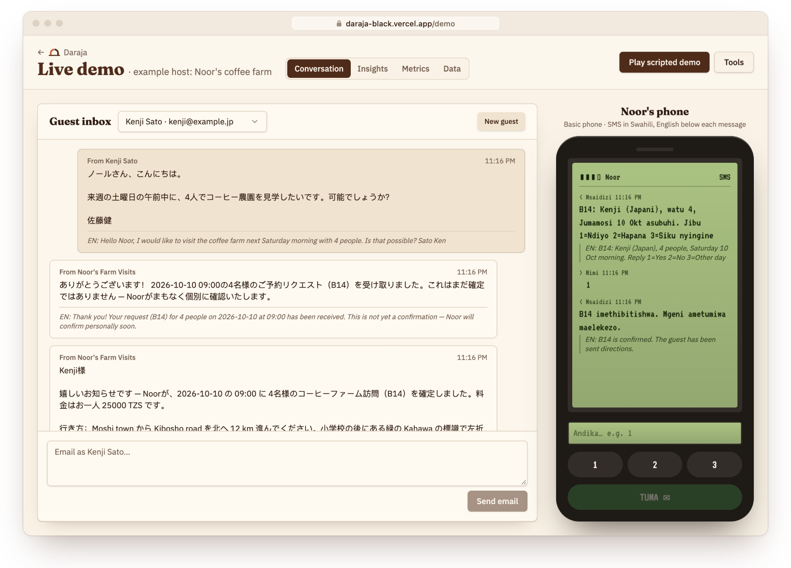
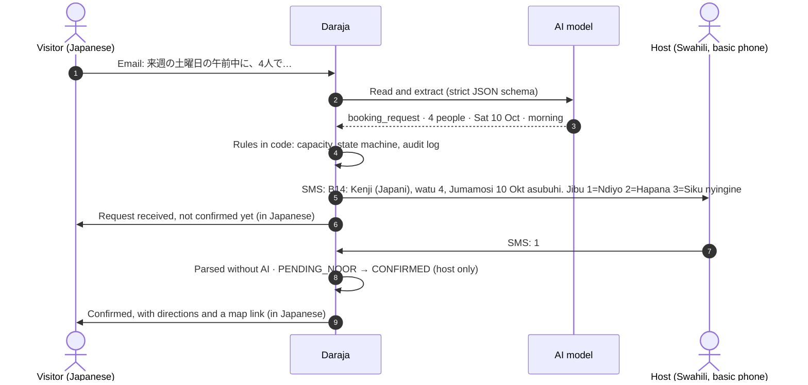
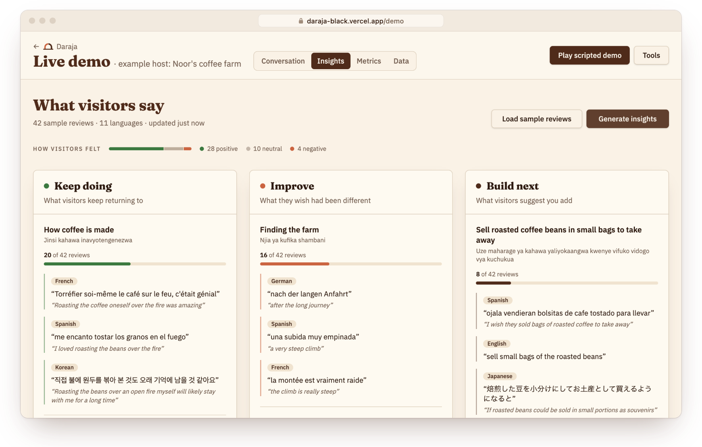
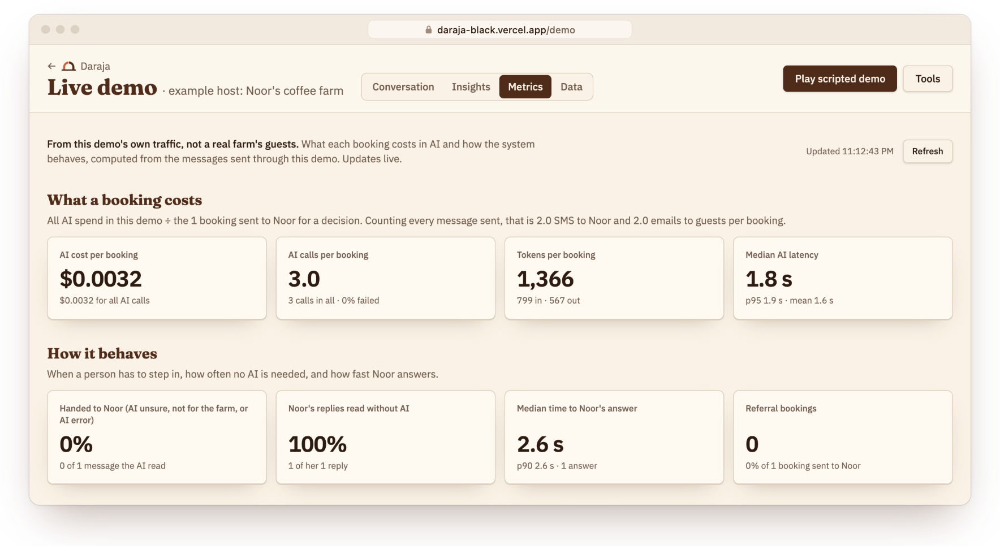
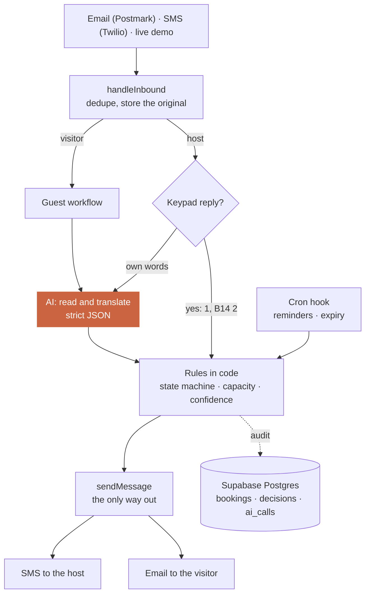
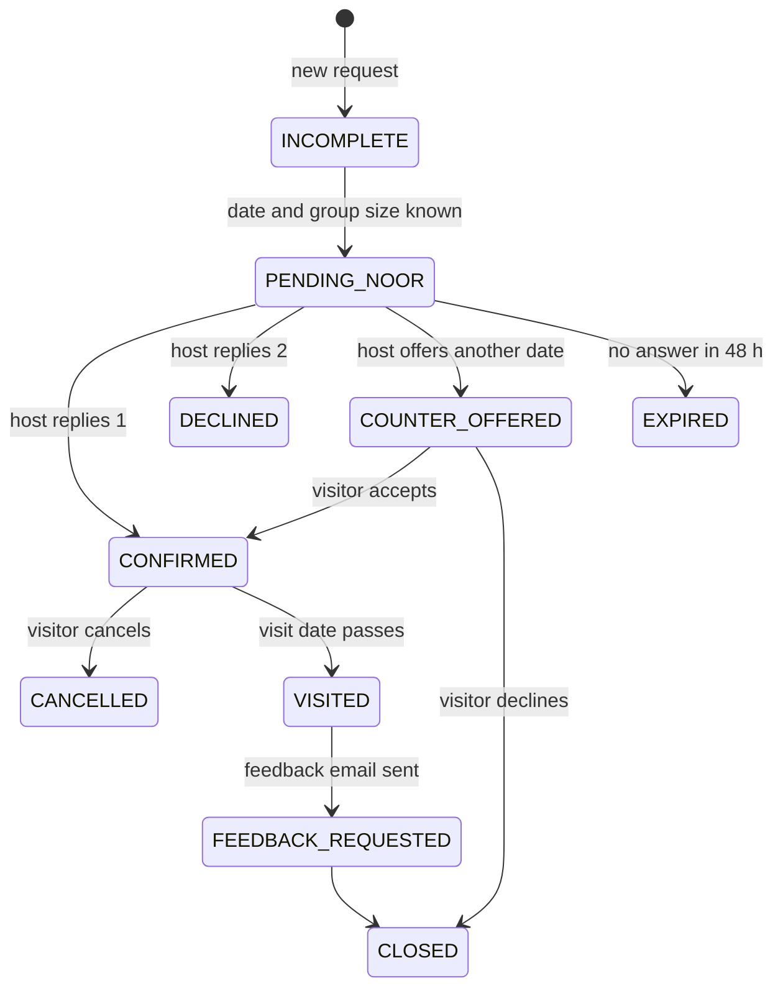

<div align="center">

<picture>
  <source media="(prefers-color-scheme: dark)" srcset="docs/brand/daraja-horizontal-reversed.svg">
  
</picture>

<h3>An AI front desk for small tourism hosts who run on a basic phone</h3>

Visitors write in any language. The host answers with one digit by SMS.<br>
The AI reads and translates. Code decides. The host always has the final say.

**[Open the live demo →](https://daraja-black.vercel.app)**

[How it works](#how-it-works) · [Why AI](#why-ai-and-where-we-dont-use-it) · [Proof](#proof) · [Architecture](#architecture) · [Run it locally](#run-it-locally)

<br>

<a href="https://daraja-black.vercel.app/demo"></a>

<sub>A real run of the live demo. Kenji writes in Japanese, Noor gets one SMS in Swahili and replies <b>1</b>, and Kenji's confirmation comes back in Japanese.</sub>

</div>

<br>

## The problem

A small rural host can lose a booking because an email went unread, or arrived in a language nobody on the farm reads.

Our example host is **Noor**, the persona in the hackathon's Tourism brief. She grows coffee on a smallholding and welcomes a handful of visitors a month, mostly by word of mouth. Her basic phone stays at the house while she works, and she reads Swahili. Her visitors write in German, French, Japanese or Spanish.

**Daraja** sits between them. Visitors email as they normally would. The host gets one short SMS in her language and answers with the keypad. Nobody installs anything.

## How it works

1. **A visitor emails, in any language.** One AI call reads it into strict JSON: what they want, the date, the time slot and how many people. Relative dates like 来週の土曜日 (_next Saturday_) are resolved against a calendar in the prompt.
2. **The host gets one SMS in Swahili** and answers with the keypad: **1** yes, **2** no, **3** another day. With several requests waiting, she adds the code (`B14 1`). Keypad replies are read by code, without AI.
3. **Only the host can confirm.** The visitor gets the confirmation in their own language, with directions and a Google Maps link added after translation, so the AI never touches it.



If the host writes in her own words instead, Daraja reads its understanding back to her and waits for a **1** before anything is sent.

## What visitors say

The Tourism brief names where AI adds value: reading scattered reviews and telling the operator **what visitors keep returning to, what they wish had been different, and what to build next.** Daraja answers those three questions for a host who will only ever read them as SMS.



- **Each review is read once**, when it arrives: what the visitor loved, wished and suggested, each with a short quote in their own words.
- **Every quote is checked in code** against the review, whole words only. An invented quote is dropped and counted.
- **Counting is code, not AI:** each insight is the number of distinct reviews that say it.
- **Noor gets two or three Swahili lines.** A line without its count, or too long for one SMS, is replaced by a fixed template.

What Noor received for the 42 sample reviews (11 languages, written for the demo):

> Wageni walipenda jinsi kahawa inavyotengenezwa: wageni 20 kati ya 42. Endelea hivyo.<br>
> Cha kuboresha ni njia ya kufika shambani: wageni 16 kati ya 42. Rahisisha maelekezo.<br>
> Wageni walipendekeza kuuza maharage ya kahawa yaliyokaangwa ya kuchukua nyumbani: wageni 8 kati ya 42.

<sub>Visitors loved how coffee is made: 20 of 42. · Improve the way to the farm: 16 of 42. · Visitors suggested selling roasted beans to take home: 8 of 42.</sub>

**Good reviews bring the next visitors.** A happy reviewer gets a personal code in the thank-you email (like `LENA-K7P`). When a friend quotes it, the new booking is linked and Noor's SMS says so: `B15: Tom (Ujerumani), rafiki wa Lena, …` (_friend of Lena_). Codes are matched in code, never guessed by the AI.

## Why AI, and where we don't use it

AI is used only where rules can't do the job: understanding free text in any language. That takes six narrow model calls, each returning strict JSON, with no agent framework. Everything that commits the host to something is plain code.

<table>
<tr>
<th width="50%" align="left">The AI reads and writes</th>
<th width="50%" align="left">Code decides</th>
</tr>
<tr>
<td valign="top">

- Reads a visitor's email: intent, date, slot, group size
- Translates between the visitor's language and the host's
- Understands the host's own words, then reads them back
- Reads each review: what visitors loved, wished and suggest
- Groups suggestions by meaning and writes the host's summary SMS

</td>
<td valign="top">

- Who may confirm a booking: only the host · [`booking-state.ts`](packages/engine/src/booking-state.ts)
- Keypad replies like `1` or `B14 2` · [`host-replies.ts`](packages/engine/src/host-replies.ts)
- Capacity, reminders and expiry · [`guest.ts`](packages/engine/src/guest.ts), [`timers.ts`](packages/engine/src/timers.ts)
- Counting reviews and checking quotes · [`insights.ts`](packages/engine/src/insights.ts), [`feedback.ts`](packages/engine/src/feedback.ts)
- Referral codes and the cost of every AI call · [`referrals.ts`](packages/engine/src/referrals.ts), [`metrics.ts`](packages/engine/src/metrics.ts)

</td>
</tr>
</table>

## Proof

The AI is scored on labelled data with the real model (`gpt-5.4-mini`, reasoning effort low). Every answer is cached, so the numbers can be regenerated without paying again.

| Suite                              | Cases | Result                                                                     |
| ---------------------------------- | ----- | -------------------------------------------------------------------------- |
| Guest emails, 13 languages         | 56    | Every field right **56/56** (95% CI 94–100%), wrong but confident **0/56** |
| Answers to a date the host offered | 7     | **7/7** read safely: only an explicit yes confirms                         |
| The host's free-text replies       | 18    | Intent **18/18**, wrong but confident **0/18**                             |
| Reviews, 11 languages              | 42    | Sentiment 41/42, points F1 89%, ideas 19/19, quotes **165/165** verbatim   |
| Safety: the engine under attack    | 12    | **12/12**: no booking confirmed except from the host's own phone           |

> [!NOTE]
> The data was written by us, the sets are small, and the prompts were tuned on them, so expect lower scores on real messages. Method, intervals and limits: [docs/eval.md](docs/eval.md).

**253 unit tests** cover every workflow against an in-memory database, without calling the model (engine 160, eval 52, web app 41). **11 end-to-end checks** go through the real webhooks, the real model and a real Postgres. [CI](.github/workflows/ci.yml) runs typecheck, lint, tests, build and formatting on every pull request.

### What it costs

A booking (the visitor's request, then the host's yes) takes **3 AI calls, about 1,300 tokens and about $0.003** at OpenAI's list price for `gpt-5.4-mini` ([`pricing.ts`](packages/engine/src/pricing.ts), checked 3 Oct 2026). The host's keypad answers use no AI at all.



## Explainability and guardrails

Every inbound message leaves a row in the `decisions` table: what the model understood, how sure it was, which model it was, and what the code did. Two rows from a real run:

| Message       | Understood                                                   | Read by        | Action                 |
| ------------- | ------------------------------------------------------------ | -------------- | ---------------------- |
| Kenji's email | `booking_request`, 4 people, 10 Oct, 09:00 · confidence 0.98 | `gpt-5.4-mini` | `request_sent_to_noor` |
| Noor's `1`    | `approve` B14                                                | `regex`        | `approve`              |

The host's decision never went through the AI. Every message also keeps its original text, the translation the other side saw, and an English version for reviewers.

- **The host decides.** The state machine checks who is acting: `PENDING_NOOR → CONFIRMED` only on the host's reply, and a date she offered is confirmed only on the visitor's explicit yes.
- **AI output is data, not actions.** Structured output against a strict JSON schema; code maps intents to actions.
- **Unsure means a person decides.** Below 0.75 confidence, the message goes to the host as a question.
- **Nothing waits forever.** A reminder to the host after 24 h; after 48 h the request expires and the visitor gets an apology.

<details>
<summary><b>All guardrails</b></summary>
<br>

| Guardrail               | How it's enforced                                                                                                                                       |
| ----------------------- | ------------------------------------------------------------------------------------------------------------------------------------------------------- |
| Free text is read back  | `Nimeelewa: … Jibu 1 kutuma, 2 kughairi` (_I understood …, reply 1 to send, 2 to cancel_); an old read-back never catches a reply meant for a newer one |
| Quotes need evidence    | A review quote must appear word for word in the review                                                                                                  |
| Every AI call is logged | `ai_calls`: task, model, tokens, latency, linked to its message and booking                                                                             |
| AI outage               | The raw message reaches the host untranslated, and the visitor is told she'll reply                                                                     |
| Capacity                | If a request would overfill a tour slot, the host's SMS says `ZIDI!` (_too many_)                                                                       |
| Repeated webhooks       | Deduplicated by the provider's message id                                                                                                               |
| Authenticated webhooks  | Twilio signature, Postmark basic auth, a secret for the cron hook; real channels stay off unless `PHASE2_ENABLED=true`                                  |
| One way out             | Every outbound message goes through one function ([`context.ts`](packages/engine/src/context.ts)), so channels can be swapped in one place              |

</details>

## Architecture



The engine depends on two interfaces, `Repo` (all data access) and `Ai` (all model calls). Production wires Supabase and OpenAI; tests wire in-memory versions of both.

| Layer    | Tools                                                              | Why                                                                                     |
| -------- | ------------------------------------------------------------------ | --------------------------------------------------------------------------------------- |
| Frontend | TanStack Start, React 19, Tailwind CSS v4, shadcn/ui               | One app for the landing page and the live demo, which updates through Supabase Realtime |
| Backend  | Server functions on Vercel, a TypeScript engine, Turborepo and bun | Plain code with a booking state machine; channels and storage plug in behind interfaces |
| Agents   | OpenAI `gpt-5.4-mini`, Responses API, strict JSON schemas          | Six narrow calls, one per job, no agent framework                                       |
| Database | Supabase Postgres with row-level security                          | Waiting for the host is a row, not a running process; every AI call is logged           |
| APIs     | Twilio SMS, Postmark email, Google Maps links                      | One way in and one way out, so real sending is a single function to add                 |
| Testing  | Vitest, a labelled eval, GitHub Actions                            | Every workflow is tested; the eval measures the real model                              |

<details>
<summary><b>Repository layout</b></summary>

```
apps/
  web/                    TanStack Start app (Vercel)
    src/routes/           thin route files: URL, head, search params, webhooks
    src/features/landing/ landing page and the wizard into the demo
    src/features/demo/    live simulator: guest inbox, the host's phone, Insights, Metrics, Data
packages/
  engine/                 workflows (inbound, guest, host, timers, reviews, insights, referrals)
                          behind Repo and Ai; metrics and pricing
  eval/                   labelled datasets, cached runner, safety suite
  db/                     Supabase types, admin client, migrations
  ui/                     design system: shadcn components and theme
  eslint-config/          shared lint rules
  typescript-config/      shared strict tsconfig
docs/
  brand/                  logo files and usage guidelines
  eval.md                 how the AI is scored, results, limitations
  development.md          monorepo, UI, database and deploy notes
```

</details>

<details>
<summary><b>Booking lifecycle</b></summary>



Simplified; the full transition table is in [`booking-state.ts`](packages/engine/src/booking-state.ts).

</details>

## Run it locally

Needs Docker running, Node, and an OpenAI API key. bun and the Supabase CLI run through `npx` if they aren't installed.

```sh
OPENAI_API_KEY=sk-... make setup   # dependencies, local Supabase, migrations and seed, .env.local
make dev                           # http://localhost:8080, and /demo for the live simulator
```

| Command         | What it does                                                       |
| --------------- | ------------------------------------------------------------------ |
| `make check`    | Typecheck, unit tests, lint, format check and production build     |
| `make e2e`      | End to end through the real webhooks, printing the transcript      |
| `make eval`     | Score the AI on the labelled sets (cached; shows paid calls first) |
| `make db-reset` | Wipe the local database and re-seed it                             |
| `make`          | List every target                                                  |

Production runs on Vercel: see [Deploying to Vercel](docs/development.md#deploying-to-vercel).

<details>
<summary><b>Configuration</b></summary>
<br>

Set in `apps/web/.env.local` (written by `make setup`, never committed):

| Variable                                                                                          | Purpose                                                                                  |
| ------------------------------------------------------------------------------------------------- | ---------------------------------------------------------------------------------------- |
| `OPENAI_API_KEY`, `AI_MODEL`, `AI_REASONING_EFFORT`, `AI_GATEWAY_URL`                             | Model access: OpenAI directly, or any OpenAI-compatible gateway                          |
| `SUPABASE_URL`, `SUPABASE_SERVICE_ROLE_KEY`, `VITE_SUPABASE_URL`, `VITE_SUPABASE_PUBLISHABLE_KEY` | Database. The service key stays on the server; the browser only reads, for the simulator |
| `PHASE2_ENABLED`, `TWILIO_AUTH_TOKEN`, `POSTMARK_INBOUND_USER`, `POSTMARK_INBOUND_PASS`           | The real SMS and email webhooks, off unless `PHASE2_ENABLED=true`                        |
| `LOVABLE_CRON_SECRET`                                                                             | Authenticates the timers hook                                                            |

</details>

## Status and next steps

- **Live on Vercel, with simulated channels.** The demo sends no real SMS or email. The Twilio and Postmark webhooks are built and tested end to end locally; real sending is next.
- **One host today.** The Swahili templates and the farm's name live in code. Next is per-host settings, so a second host is a row in the database, not a code change.
- **Measured on our own data.** A pilot with real emails and reviews is the next proof.
- **Language review.** The Swahili wording needs a native speaker's check.

<br>

<div align="center">

<picture>
  <source media="(prefers-color-scheme: dark)" srcset="docs/brand/daraja-mark-reversed.svg">
  
</picture>

<sub>Built for the Hack-Nation × World Bank Youth Summit Global AI Hackathon 2026 · <i>Small AI for Development</i>, Tourism track.<br>
The first version was made with <a href="https://lovable.dev">Lovable</a>; this repo turns it into a tested monorepo. Brand files: <a href="docs/brand">docs/brand</a>.</sub>

</div>
