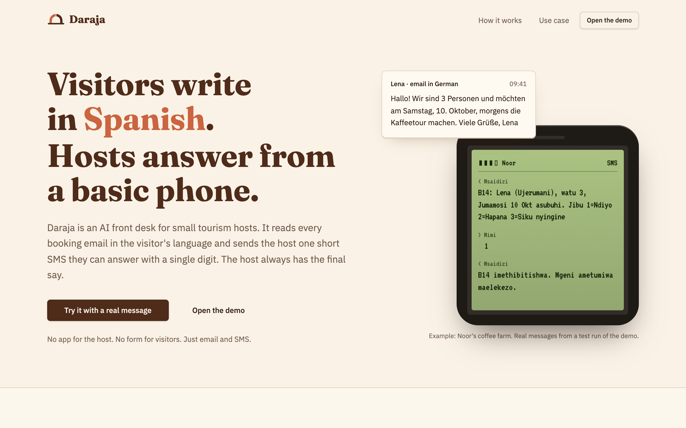
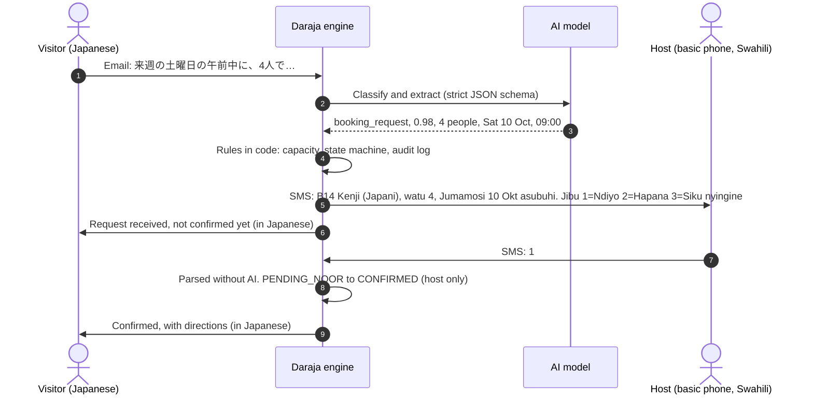
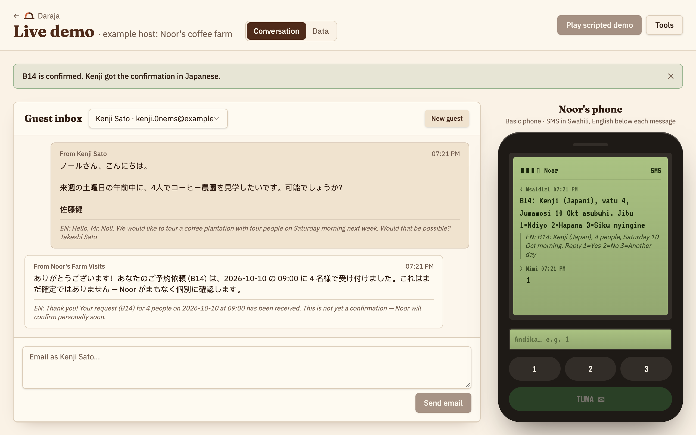
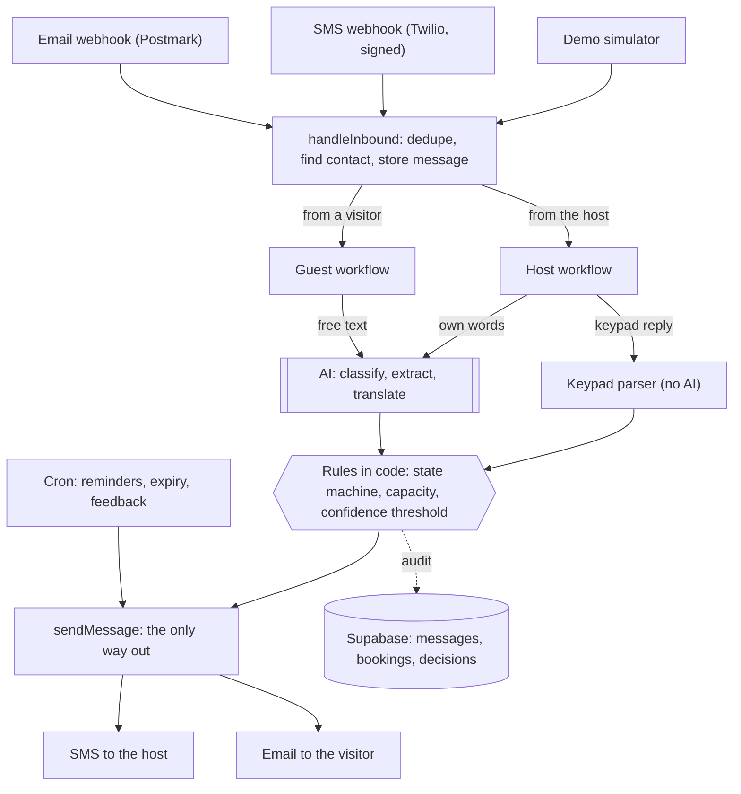
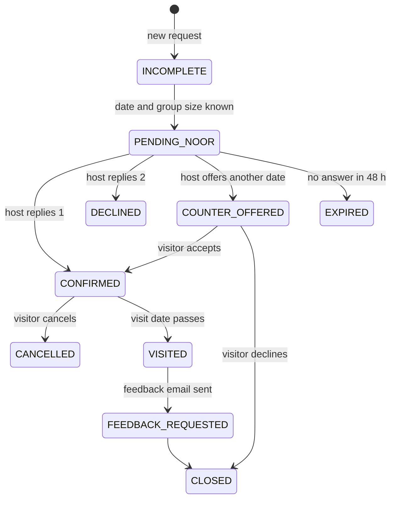

<div align="center">

<picture>
  <source media="(prefers-color-scheme: dark)" srcset="docs/brand/daraja-horizontal-reversed.svg">
  
</picture>

### An AI front desk for small tourism hosts who run on a basic phone.

Visitors write in any language. The host answers with one digit by SMS.<br>
The AI reads and translates. **Code decides, and only the host confirms.**

[](https://github.com/fritzschack/pixel-perfect-clone/actions/workflows/ci.yml)


[How it works](#how-it-works) · [Why AI](#why-ai-and-where-we-dont-use-it) ·
[Explainability](#explainability-and-guardrails) · [Evidence](#evidence-it-works) ·
[Architecture](#architecture) · [Quick start](#quick-start)



</div>

## The problem

A small rural host can lose a booking simply because an email went unread, or arrived in a language
nobody on the farm reads. Our example host is **Noor**, the persona in the hackathon's Tourism brief:

- She farms two hectares in the Ondera highlands, with coffee on the upper slope, and gets a handful
  of visitors a month, mostly by word of mouth.
- Her phone is a basic phone, and it stays at the house while she works the slope.
- She reads Swahili. Her visitors don't (in the demo they write in German, French, Japanese and
  Spanish).

So emails go unanswered, or get answered too late, in a language the visitor can't read.

**Daraja** (Swahili for _bridge_) sits between the two. Visitors email as they normally would. The
host gets one short SMS and answers with a keypad. Neither side installs anything.

## How it works



The host's keypad covers the whole flow: **1** accepts, **2** declines, **3** offers another day.
With several requests waiting, she types the code (`B14 1`). If she writes in her own words instead,
Daraja reads its understanding back to her and waits for a **1** before anything is sent.

<div align="center">

<br><sub>The live demo after a real run: Kenji's email, Noor's SMS with an English line for reviewers, and her reply.</sub>
</div>

## Why AI, and where we don't use it

AI is used only where rules can't do the job: reading free text in any language. Everything that
commits the host to something is plain code.

| The AI does                                                         | Why it needs AI                                                               |
| ------------------------------------------------------------------- | ----------------------------------------------------------------------------- |
| Reads a visitor's email and extracts date, group size and time slot | Free text, any language, relative dates ("next Saturday morning")             |
| Translates both ways: visitor → host, host → visitor                | Any visitor language, without writing templates for each one                  |
| Interprets the host's free-text replies                             | So she isn't limited to digits, with a read-back before acting on them        |
| Turns post-visit feedback into themes and a monthly SMS summary     | Reviews arrive in many languages; the host gets two or three lines in Swahili |

| Code does (no AI)                                                | Where                                                                                    |
| ---------------------------------------------------------------- | ---------------------------------------------------------------------------------------- |
| Decides what happens to a booking, and who may confirm it        | [`booking-state.ts`](packages/engine/src/booking-state.ts)                               |
| Parses keypad replies (`1`, `B14 2`, `14-1`)                     | [`host-replies.ts`](packages/engine/src/host-replies.ts)                                 |
| Checks capacity, sends reminders, expires stale requests         | [`guest.ts`](packages/engine/src/guest.ts), [`timers.ts`](packages/engine/src/timers.ts) |
| Writes the Swahili SMS (dates, slots, one 160-character segment) | [`format.ts`](packages/engine/src/format.ts)                                             |

## Explainability and guardrails

**Every inbound message leaves an audit row** in the `decisions` table: what the model understood,
how sure it was, which model it was, and what the code did about it. These are the two rows from the
run in the screenshot above, as shown in the demo's **Data** tab:

| Message       | intent            | confidence | entities                                                                | model          | action_taken           | routed_to_human |
| ------------- | ----------------- | ---------- | ----------------------------------------------------------------------- | -------------- | ---------------------- | --------------- |
| Kenji's email | `booking_request` | 0.98       | `{"date_from":"2026-10-10","slot":"09:00","party_size":4,"missing":[]}` | `gpt-5.4-mini` | `request_sent_to_noor` | true            |
| Noor's "1"    | `approve`         | 1          | `{"choice":1,"booking":14}`                                             | `regex`        | `approve`              | false           |

The second row shows that the host's decision never went through the AI.

Every message also keeps its **original text**, the **translation** the other side saw, and an
**English** version for reviewers.

| Guardrail                      | How it's enforced                                                                                                                                        |
| ------------------------------ | -------------------------------------------------------------------------------------------------------------------------------------------------------- |
| Only the host confirms         | The state machine checks the actor: `PENDING_NOOR → CONFIRMED` is allowed for the host only ([`booking-state.ts`](packages/engine/src/booking-state.ts)) |
| AI output is data, not actions | Structured output against a strict JSON schema; code maps intents to actions ([`ai/tasks.ts`](packages/engine/src/ai/tasks.ts))                          |
| Unsure means a human decides   | Confidence below 0.75 or `unknown`: the message goes to the host as a question, or she's asked to rephrase                                               |
| Free text is read back         | "Nimeelewa: … Jibu 1 kutuma, 2 kughairi" (I understood …, reply 1 to send, 2 to cancel)                                                                  |
| AI outage                      | The raw message reaches the host untranslated, and the visitor is told she'll reply                                                                      |
| Nothing waits forever          | Reminder to the host after 24 h; after 48 h the request expires and the visitor gets an apology                                                          |
| Capacity                       | If a request would overfill a tour slot, the host's SMS says `ZIDI!` (too many)                                                                          |
| Repeated webhooks              | Deduplicated by provider message id                                                                                                                      |
| Authenticated webhooks         | Twilio HMAC signature, Postmark basic auth, a secret for the cron hook. Real channels stay off unless `PHASE2_ENABLED=true`                              |
| One way out                    | Every outbound message goes through a single function ([`context.ts`](packages/engine/src/context.ts)), so channels can be swapped in one place          |

## Evidence it works

| Check                                   | What it covers                                                                                                                                                                                          | Command                              |
| --------------------------------------- | ------------------------------------------------------------------------------------------------------------------------------------------------------------------------------------------------------- | ------------------------------------ |
| **34 engine unit tests** (~0.1 s)       | Every workflow against an in-memory database and a scripted AI: requests, missing details, capacity, duplicates, keypad replies, counter-offers, read-back, low confidence, AI outage, timers, feedback | `make test`                          |
| **10 end-to-end checks**                | Real webhooks, the real model and a real Postgres: language detected, details extracted, Swahili SMS sent, signed SMS reply accepted, booking confirmed, confirmation email in German, cron auth        | `make e2e`                           |
| **The same 10 on the production build** | The built Cloudflare Worker running locally in workerd                                                                                                                                                  | `make e2e-worker`                    |
| **CI**                                  | Typecheck, lint, tests, build and formatting on every pull request                                                                                                                                      | [`ci.yml`](.github/workflows/ci.yml) |

## Architecture



The engine depends on two interfaces, `Repo` (all data access) and `Ai` (all model calls). Production
wires Supabase and an OpenAI-compatible gateway; tests wire an in-memory repo and a scripted AI.

```
apps/
  web/                    TanStack Start app (Cloudflare Worker)
    src/routes/           thin route files: URL, head, search params, webhooks
    src/features/landing/ landing page and the wizard into the demo
    src/features/demo/    live simulator: guest inbox, the host's phone, Data tab
packages/
  engine/                 workflows (inbound, guest, host, timers, insights) behind Repo and Ai
  db/                     Supabase types, admin client, migrations
  ui/                     design system: shadcn components and theme
  eslint-config/          shared lint rules
  typescript-config/      shared strict tsconfig
docs/
  brand/                  logo files and usage guidelines
  development.md          monorepo, UI and database notes
```

<details>
<summary><b>Booking lifecycle</b></summary>



Simplified; the full transition table is in [`booking-state.ts`](packages/engine/src/booking-state.ts).

</details>

## Quick start

Needs Docker running, Node, and an OpenAI API key. bun, the Supabase CLI and wrangler run through
`npx` if they aren't installed.

```sh
OPENAI_API_KEY=sk-... make setup   # dependencies, local Supabase in Docker, migrations and seed, .env.local
make dev                           # http://localhost:8080 (landing) and /demo (live simulator)
```

| Command             | What it does                                                       |
| ------------------- | ------------------------------------------------------------------ |
| `make check`        | Typecheck, unit tests, lint, format check and production build     |
| `make e2e`          | End-to-end through the real webhooks, printing the full transcript |
| `make deploy-local` | The built Cloudflare Worker on http://localhost:8787               |
| `make db-reset`     | Wipe the local database and re-seed it                             |
| `make`              | List every target                                                  |

Configuration lives in `apps/web/.env.local` (written by `make setup`, never committed):

| Variable                                                                                | Purpose                                                                                                          |
| --------------------------------------------------------------------------------------- | ---------------------------------------------------------------------------------------------------------------- |
| `OPENAI_API_KEY`, `AI_MODEL`, `AI_GATEWAY_URL`                                          | Model access. Locally: OpenAI directly. In Lovable: Lovable's AI gateway                                         |
| `SUPABASE_URL`, `SUPABASE_SERVICE_ROLE_KEY`, `VITE_SUPABASE_*`                          | Database. The service key stays on the server; the browser gets read-only access for the simulator               |
| `PHASE2_ENABLED`, `TWILIO_AUTH_TOKEN`, `POSTMARK_INBOUND_USER`, `POSTMARK_INBOUND_PASS` | The real SMS and email webhooks. Off unless `PHASE2_ENABLED=true` (the local setup turns them on for `make e2e`) |
| `LOVABLE_CRON_SECRET`                                                                   | Authenticates the timers hook                                                                                    |

More in [docs/development.md](docs/development.md).

## Status and next steps

- **Phase 1 (this repo):** a working engine with simulated channels. The demo sends no real SMS or
  email. The Twilio and Postmark inbound webhooks are implemented and tested end to end locally;
  sending real SMS and email is the next step.
- **One host today:** the Swahili templates and the farm's name live in code. Next is per-host
  settings (language, tours, capacity), so a second host is a row in the database, not a code change.
- **Not measured yet:** classification accuracy on a labelled set of real emails. The end-to-end
  test covers the main path with the real model.
- **Language review:** the Swahili wording needs a native speaker's check.

## Context

Built for the Hack-Nation × World Bank Youth Summit Global AI Hackathon 2026, _Small AI for
Development_, Tourism track. The first version was generated with [Lovable](https://lovable.dev);
this repo restructures it into a tested monorepo. Brand files and guidelines: [`docs/brand`](docs/brand).
